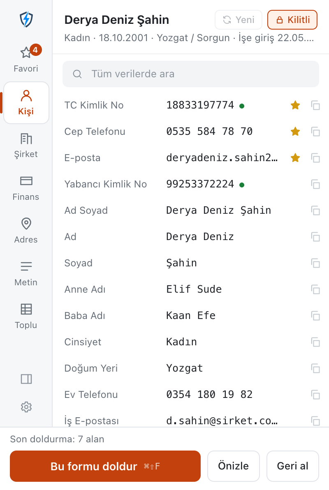
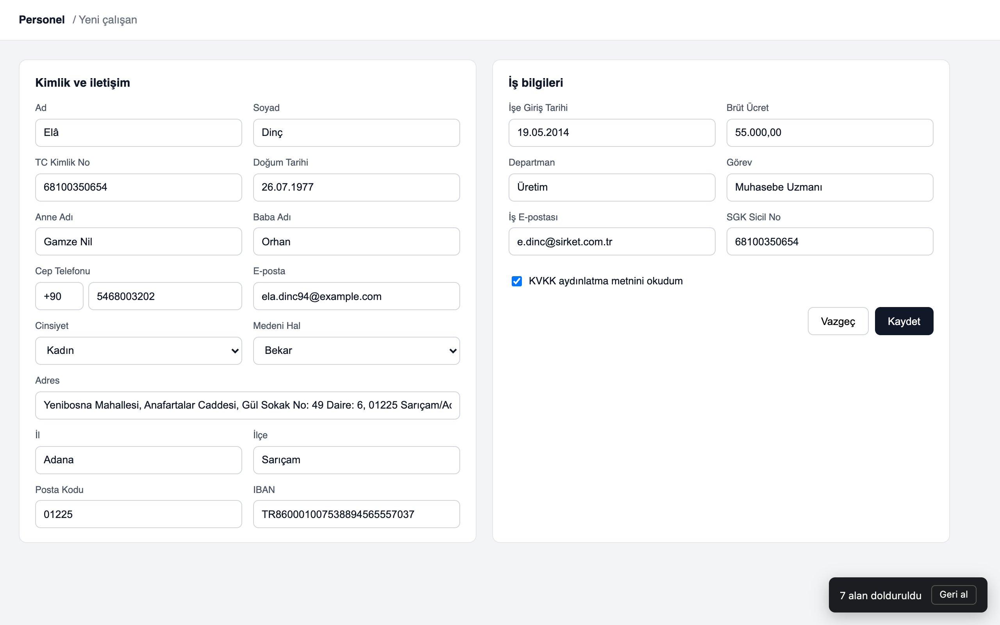

# Data Helper

<p align="center">
  
</p>

Turkish test data and one-click form filling for Chrome. Valid TCKN, VKN and IBAN; one consistent person and company; fill the form you are on with preview and undo; bulk CSV / XLSX. Everything runs in your browser.

[Chrome Web Store](https://chromewebstore.google.com/detail/data-helper/hboimhjgdphpokonjindjhgoihkmboli) · [Website](https://osmnnl.github.io/TestDataHelper/) · [Privacy](PRIVACY.md) · [Issues](https://github.com/osmnnl/TestDataHelper/issues)

<p align="center">
  
  
</p>

## What it does

- **Fills the form you are on.** Click into a form and press `Ctrl+Shift+F` (Mac: `⌘⇧F`). Only that form is filled; the rest of the page is left alone. `Alt+Shift+F` fills the focused field.
- **Recognises the field.** Reads the label, legend, aria-label and placeholder, in Turkish or English. Mother's name, father's name and company name each get their own value. Custom dropdowns, input masks and date formats are handled.
- **Preview and undo.** The preview lists every field found and the value it will write; one click undoes the last fill.
- **One consistent person.** Name, TCKN, e-mail, phone, IBAN, address and dates belong to the same fictional person; city, district, postal code and area code agree. Lock the person to keep it across fills.
- **Data that passes validation.** Over 60 data types in four groups (person, company, finance, address/date/text), with search and favorites. TCKN and VKN check digits, IBAN mod 97, card numbers with Luhn.
- **Bulk.** Any number of people as CSV or XLSX, with the columns you choose, in the order you choose.
- **Right-click menu.** Fill one field, fill the form, insert a specific value or pick an option from a list.
- **Side panel**, light and dark theme, Turkish interface.

## Install from source

```bash
git clone https://github.com/osmnnl/TestDataHelper.git
cd TestDataHelper
npm ci
npm run build
```

Load `dist/` as an unpacked extension in `chrome://extensions/` (Developer mode). Works in Chrome, Edge, Brave and other Chromium browsers (Chrome 114+).

## Permissions

| Permission | Why |
|---|---|
| `activeTab` | Fill the tab you are using, only when you ask (button, shortcut, right-click) |
| `scripting` | Load the fill engine into that tab at that moment. The engine ships inside the extension; no remote code |
| `storage` | Current person, favorites, settings, bulk templates |
| `contextMenus` | The "Data Helper" right-click menu |
| `sidePanel` | Open Data Helper in the side panel |
| `<all_urls>` (optional) | Asked per site, only when you fill from the side panel |

No content script runs on any page in the background. No server, no analytics, no tracking. All generated values are fake and for testing only. See [PRIVACY.md](PRIVACY.md).

## Development

- `npm run dev` — Vite dev server (landing page)
- `npm run build` — type-check and build the extension into `dist/`
- `npm run build:pages` — build the GitHub Pages site
- `npm run lint` — ESLint

React 19, TypeScript, Vite, Manifest V3. No runtime dependencies beyond React.

## License

MIT

## Contact

[GitHub Issues](https://github.com/osmnnl/TestDataHelper/issues) · osmnnldev@gmail.com
